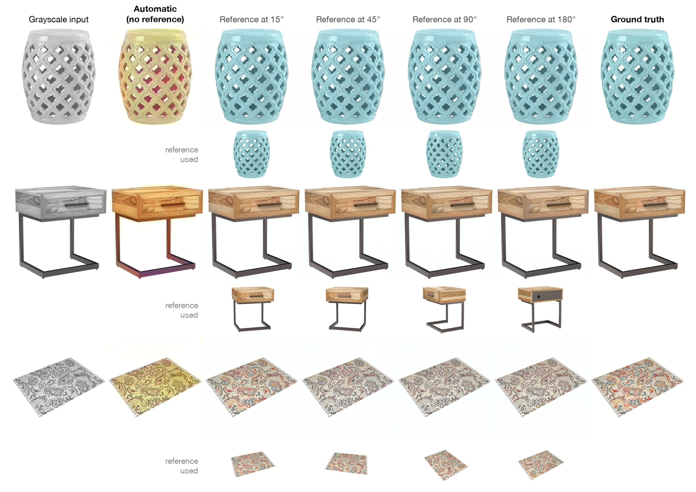
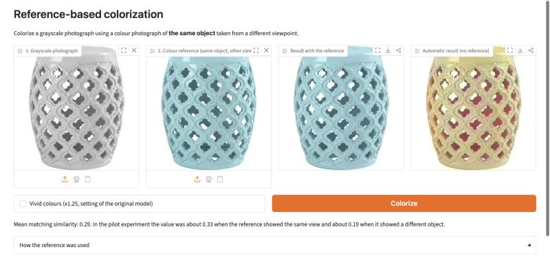

# Reference-Based Grayscale Image Colorization

Term paper, Faculty of Informatics, Vytautas Magnus University\
BSc "Informatics Systems", 7th semester, autumn 2026\
Author: Oleksandr Klepachevskyi · Supervisor: Monika Briedienė

## Title

Reference-Based Grayscale Image Colorization Using a Color Photograph of the Same Object from a Different Viewpoint

## Goal

To develop and evaluate a reference-based image colorization system that colors a grayscale
photograph using a color reference of the same object from a different viewpoint, focusing on
how viewpoint difference affects result quality.

## First results

Pilot experiment: 12 objects from the public ABO dataset, 48 grayscale targets, colour references
of the same object taken from 0° to 180° away. The original colour image of each target is the
ground truth.



| Condition | PSNR on the object, dB |
|---|---|
| Grayscale input (no colour) | 22.4 |
| Automatic colorization, no reference | 21.3 |
| Reference shows a different object | 25.2 |
| Reference shows the same object (all angles) | 36.6 |

- A reference showing the same object beats automatic colorization on all 48 targets, by about 15 dB.
- On average, the viewpoint difference costs 2–3 dB. Objects whose back or side looks different
  lose up to 8 dB.

Tables, per-object results and limitations: [docs/pilot-results.md](docs/pilot-results.md).

## Tasks

1. [x] Review existing automatic and reference-based (exemplar-based) image colorization methods.
2. [x] Compare existing colorization tools and services on the market, and available open-source models.
3. [ ] Collect a small test set of image pairs: a grayscale photograph and a color reference of the same object from a different viewpoint. *Pilot set ready; own photographs in progress.*
4. [x] Build a simple prototype that colorizes a grayscale image using an existing pretrained reference-based model.
5. [ ] Conduct a preliminary analysis of how viewpoint difference affects colorization quality, comparing results with and without a reference image (PSNR, SSIM and visual assessment). *Pilot analysis done; own photographs next.*
6. [ ] Prepare documentation: literature and market analysis, chosen method, preliminary results, identified challenges, and plan for the bachelor thesis.

## Schedule

| Period | Activity | Result |
|---|---|---|
| Sep 22 – Oct 12 | Literature review and analysis of existing tools and models | Literature review draft; comparison of existing solutions |
| Oct 13 – Oct 26 | Selection of a pretrained model; collection of test image pairs | Chosen model; first version of the test set |
| Oct 27 – Nov 6 | First version of the prototype; first colorization experiments | Working prototype with first results |
| **Nov 7** | **Midterm presentation** | Literature review, prototype and first results |
| Nov 8 – Nov 28 | Preliminary evaluation: with vs. without a reference, different viewpoints | Result tables, visual comparison, identified challenges |
| Nov 29 – Dec 14 | Documentation, presentation slides, rehearsal | Completed term paper; ready for defense |
| Dec (TBA) | Final defense | Presentation + prototype |

## Repository structure

```
src/refcolor/        models, colorization pipeline, metrics
src/colorize.py      command-line prototype
src/app.py           web prototype (Gradio)
src/prepare_abo_pilot.py, src/run_pilot.py, src/make_figures.py
                     pilot experiment: data download, measurements, figures
src/verify_official_sample.py
                     check against the outputs published by the model authors
scripts/             download of the pretrained weights, checksums
examples/            sample inputs for the prototype
data/                pilot object list; own image pairs (not committed, see data/README.md)
results/pilot/       pilot measurements (metrics.csv)
docs/                literature review, market comparison, pilot results, figures
```

## Setup

```bash
python3 -m venv .venv
source .venv/bin/activate
pip install -r requirements.txt
bash scripts/setup_models.sh
```

`setup_models.sh` downloads the pretrained weights of the reference-based model (Zhang et al., 2019)
and checks their SHA-256. The weights of the automatic model (Zhang et al., 2016) are downloaded
on first use. Tested with Python 3.13. Everything runs on the CPU; on a MacBook Air M3 one image
takes about a second.

## Usage

```bash
# with a reference photograph
python src/colorize.py --target examples/stool_grayscale.jpg --reference examples/stool_reference_90deg.jpg --out stool.png

# without a reference (automatic colorization)
python src/colorize.py --target examples/stool_grayscale.jpg --out stool_automatic.png

# web prototype at http://127.0.0.1:7860
python src/app.py
```



Reproduce the pilot experiment:

```bash
python src/prepare_abo_pilot.py   # downloads 12 objects x 72 views (about 90 MB)
python src/run_pilot.py           # about 9 minutes on the CPU
python src/make_figures.py
```

## Status

November 2026: the literature review, the market comparison, the prototype and the pilot
experiment are done. Next: own photographs for the test set, the preliminary evaluation on them,
and the written report.

## Licence

The code is released under the MIT licence ([LICENSE](LICENSE)). The written documents in `docs/`
are part of the term paper and are not covered by it. The model architectures in `src/refcolor/`
are ported from the authors' implementations, and the pilot images come from the ABO dataset
(CC BY 4.0); see [THIRD_PARTY_NOTICES.md](THIRD_PARTY_NOTICES.md).
