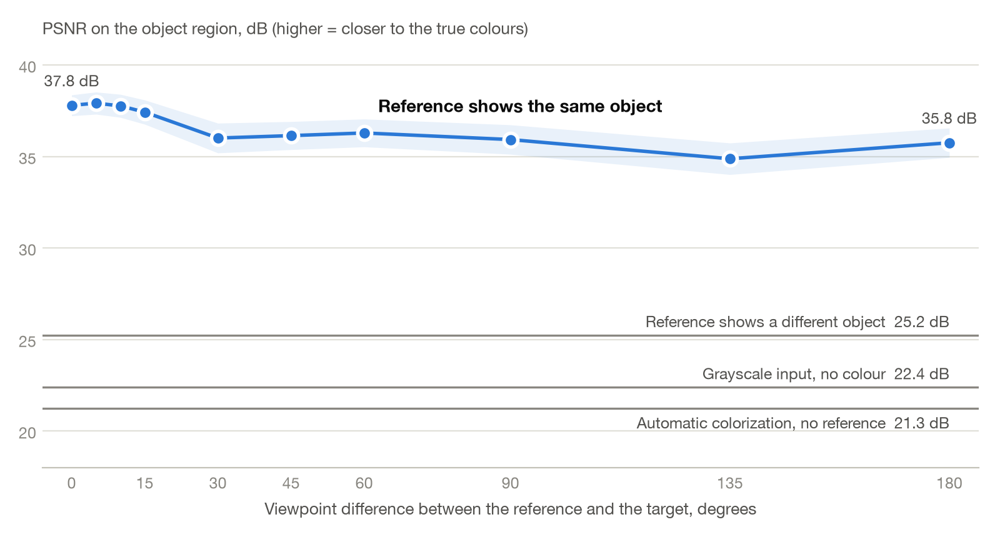
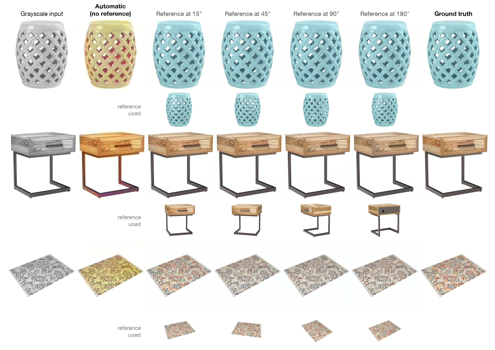
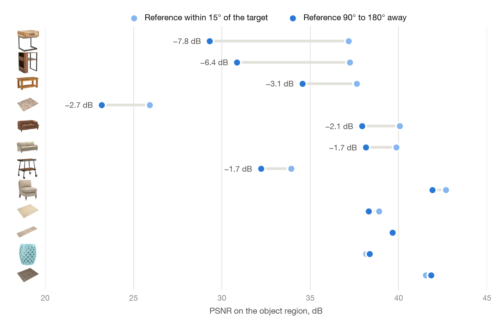

# Pilot results: viewpoint difference and colorization quality

First results for tasks 3-5 (12 November 2026). Pilot set: 12 objects from the public ABO dataset
(turntable images, one view every 5 degrees, CC BY 4.0), 4 target views per object, 48 targets.
The target is converted to grayscale; its original colour image is the ground truth.
Reproduce with `src/prepare_abo_pilot.py`, `src/run_pilot.py`, `src/make_figures.py`.

| Viewpoint difference | PSNR object, dB | PSNR full image, dB | SSIM | Matching similarity | PSNR object with official x1.25 boost, dB |
|---|---|---|---|---|---|
| 0° | 37.8 | 41.7 | 0.995 | 0.33 | 35.8 |
| 5° | 37.9 | 41.8 | 0.995 | 0.31 | 35.1 |
| 10° | 37.8 | 41.7 | 0.995 | 0.30 | 34.8 |
| 15° | 37.4 | 41.4 | 0.994 | 0.29 | 34.7 |
| 30° | 36.0 | 40.1 | 0.994 | 0.26 | 33.8 |
| 45° | 36.1 | 40.3 | 0.994 | 0.26 | 34.0 |
| 60° | 36.3 | 40.4 | 0.994 | 0.27 | 34.1 |
| 90° | 35.9 | 40.0 | 0.994 | 0.26 | 33.6 |
| 135° | 34.9 | 39.0 | 0.993 | 0.24 | 33.2 |
| 180° | 35.8 | 39.9 | 0.994 | 0.26 | 33.6 |

| Condition | PSNR object, dB | PSNR full image, dB | SSIM |
|---|---|---|---|
| Grayscale input (no colour) | 22.4 | 27.1 | 0.987 |
| Automatic colorization, no reference | 21.3 | 25.6 | 0.976 |
| Reference shows a different object | 25.2 | 29.8 | 0.987 |
| Reference shows the same object (all angles) | 36.6 | 40.6 | 0.994 |

| Object | PSNR, reference within 15° | PSNR, reference 90-180° away | Drop, dB |
|---|---|---|---|
| 833aecc5 | 37.2 | 29.3 | 7.8 |
| bb5f31f2 | 37.2 | 30.9 | 6.4 |
| fdb6c129 | 37.6 | 34.6 | 3.1 |
| 5dbb18b5 | 25.9 | 23.2 | 2.7 |
| 8735f3c4 | 40.1 | 37.9 | 2.1 |
| 54041437 | 39.9 | 38.1 | 1.7 |
| 42e0694d | 33.9 | 32.2 | 1.7 |
| 082327b7 | 42.7 | 41.9 | 0.8 |
| 08fd1ce0 | 38.9 | 38.3 | 0.6 |
| 6a1f2296 | 39.7 | 39.7 | 0.0 |
| 4c7e45bc | 38.2 | 38.4 | -0.2 |
| 94aa934f | 41.5 | 41.8 | -0.3 |

Mean cost of the official x1.25 chroma boost: 2.3 dB (PSNR object, all angles).

## Preliminary observations

1. A reference showing the same object recovers the true colours far better than automatic
   colorization at every tested angle (about +15 dB PSNR on the object region, 48 of 48 targets).
2. On average the viewpoint difference costs 2-3 dB; most of the loss appears between 15 and 30 degrees.
3. The loss depends on the object: uniformly coloured objects are unaffected, objects whose back or
   side looks different lose up to 8 dB, and fine multi-colour patterns are not reproduced well even
   with an ideal reference.
4. The x1.25 chroma boost of the official script lowers accuracy by about 2.3 dB, so it is switched
   off by default in the prototype.

Limitations: 12 objects of one domain (furniture), rendered product images with identical lighting.
Own photographs are the next step. Both models were checked against the outputs published by their
authors (`src/verify_official_sample.py`: 42.9 dB and 49.2 dB PSNR).
